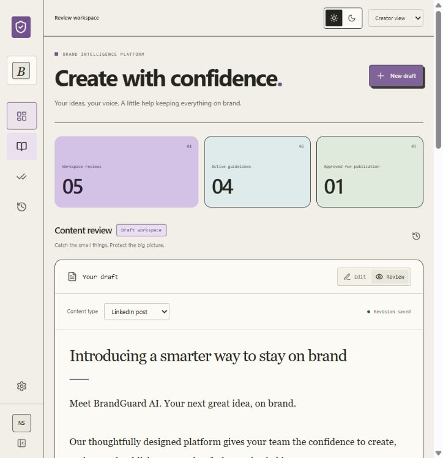
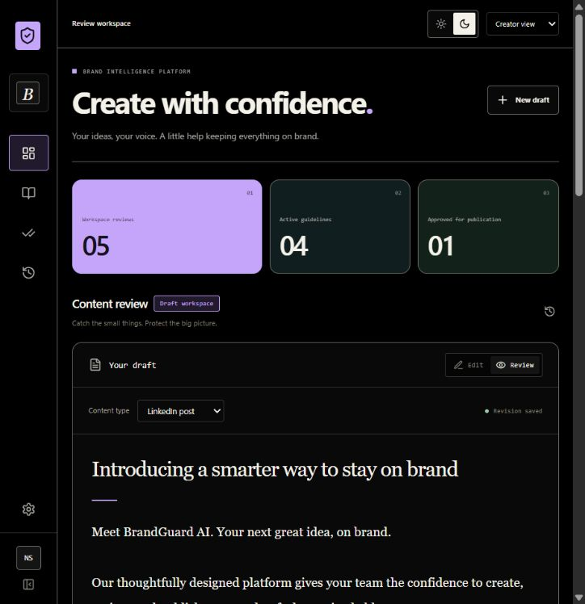
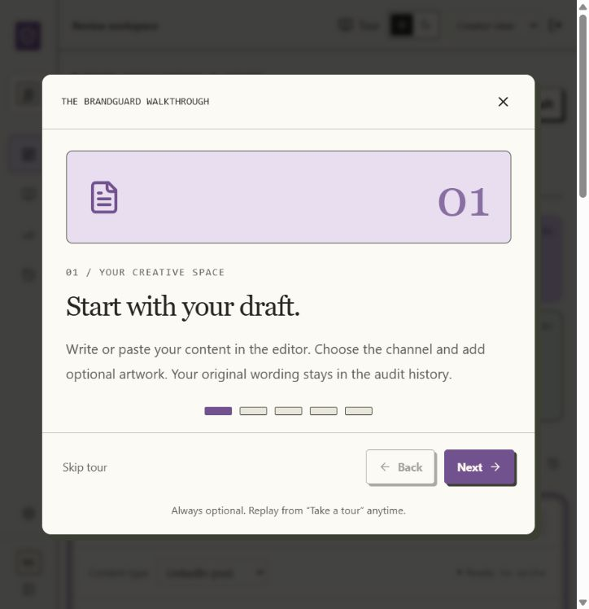
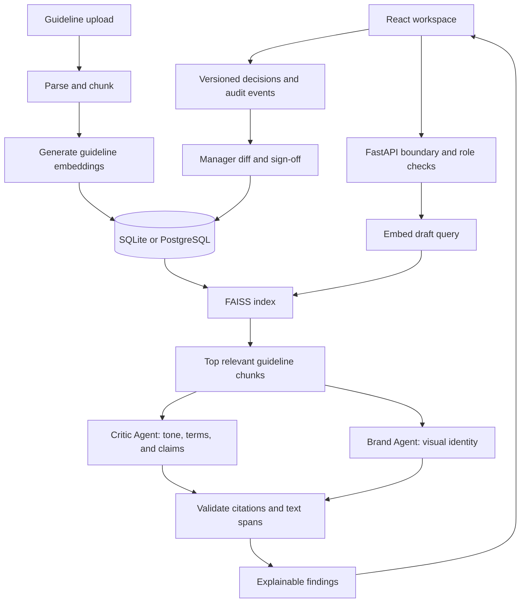

# BrandGuard AI

**Pre-publication brand governance, grounded in your guidelines.**

A React and FastAPI MVP that reviews content drafts, explains potential brand violations with source citations, preserves creator control over rewrites, and records a manager's final sign-off.

## Technology stack and versions

The library versions below are resolved from [`frontend/package-lock.json`](frontend/package-lock.json) and [`backend/requirements.lock.txt`](backend/requirements.lock.txt), rather than the version ranges in the package manifests.

| Layer                   | Technology                      | Version     | Purpose                                          |
| ----------------------- | ------------------------------- | ----------- | ------------------------------------------------ |
| Frontend                | React / React DOM               | **19.3.1**  | Application views and interactive review state   |
| Styling                 | Tailwind CSS / Vite integration | **4.3.4**   | Styling pipeline and theme support               |
| Language                | TypeScript                      | **5.7.3**   | Typed frontend contracts                         |
| Frontend build          | Vite                            | **6.4.5**   | Development server and production bundle         |
| React build integration | `@vitejs/plugin-react`          | **4.7.0**   | React development/build integration              |
| Icons                   | Lucide React                    | **0.468.0** | Interface iconography                            |
| Revision comparison     | jsdiff (`diff`)                 | **9.0.0**   | Original/revised word comparison                 |
| Backend                 | FastAPI                         | **0.162.0** | API, validation, ingestion, and orchestration    |
| ASGI server             | Uvicorn                         | **0.54.0**  | Python application server                        |
| Data validation         | Pydantic                        | **2.14.2**  | Request models and structured AI findings        |
| Database access         | SQLAlchemy                      | **2.1.8**   | Accounts, guidelines, reviews, and audit records |
| PostgreSQL driver       | psycopg                         | **3.3.8**   | Optional PostgreSQL connectivity                 |
| Vector retrieval        | FAISS CPU                       | **1.15.1**  | In-memory similarity search                      |
| Numerical operations    | NumPy                           | **2.5.4**   | Embedding vectors and normalization              |
| AI integration          | OpenAI Python SDK               | **2.54.0**  | Optional live embeddings and review agents       |
| PDF parsing             | pypdf                           | **6.21.4**  | Text extraction from readable PDFs               |
| Image validation        | Pillow                          | **12.3.0**  | Attachment format/dimension validation           |
| File uploads            | python-multipart                | **0.0.33**  | Multipart guideline ingestion                    |
| Frontend tests          | Vitest                          | **5.1.0**   | Browser-demo contract tests                      |
| Backend tests           | pytest                          | **9.2.0**   | API, accounts, and review workflow tests         |
| HTTP client/testing     | HTTPX                           | **0.28.1**  | API testing support                              |
| Frontend formatting     | Prettier                        | **3.9.10**  | Consistent source formatting                     |

**Local validation environment:** Python **3.13.0**, Node.js **24.14.0**, and SQLite **3.45.3**. SQLite is supplied by the Python runtime, so its version can differ on another machine. The Dockerfile uses the `node:24-alpine` and `python:3.13-slim` image tags; Docker Engine, Compose, and an optional PostgreSQL server are not version-pinned or validated here.

**Configured live model defaults:** `gpt-4.1-mini` for the review agents and `text-embedding-3-small` for embeddings. These are configurable model identifiers, separate from the SDK version. Live provider calls have not been exercised in the recorded local checks.

## Contents

- [Overview](#overview)
- [Features](#features)
- [Screenshots](#screenshots)
- [Architecture](#architecture)
- [Project structure](#project-structure)
- [Quick start](#quick-start)
- [Configuration](#configuration)
- [Review workflow](#review-workflow)
- [API reference](#api-reference)
- [Validation](#validation)
- [Deployment](#deployment)
- [GitHub handoff](#github-handoff)
- [Limitations and next steps](#limitations-and-next-steps)
- [Contributing and security](#contributing-and-security)
- [Documentation](#documentation)

## Overview

BrandGuard AI helps content creators and brand managers catch inconsistencies before publication. It checks drafts against active brand guidelines covering tone, terminology, promotional claims, approved facts, and visual identity.

The product is a review assistant: suggestions require a creator's decision, and publication approval requires a separate manager. Approval records a sign-off against a specific revision; it does not publish content to an external CMS.

The repository includes a complete local workflow without paid API keys, plus configurable adapters for live AI review.

## Features

| Area                     | Implemented behavior                                                                     |
| ------------------------ | ---------------------------------------------------------------------------------------- |
| Account access           | Backend-persisted creator registration, sign-in, session restoration, and sign-out       |
| Guideline administration | PDF, Markdown, TXT, and structured JSON uploads; source activation/deactivation          |
| Retrieval                | Persisted guideline embeddings and a bounded FAISS similarity search                     |
| Review agents            | Critic and Brand/Vision roles; optional concurrent live LLM execution                    |
| Explainable findings     | Exact text spans, severity, source citation, explanation, and suggested rewrite          |
| Creator control          | Explicit accept/reject actions, preserved originals, and stale-review detection          |
| Alignment score          | Transparent weighted score that updates as rewrites are accepted                         |
| Manager handoff          | Context notes, revision diff, audit trail, change requests, and sign-off                 |
| Visual review            | Offline checks of declared colors/logo placement; configurable live image review         |
| Interface                | OLED dark and warm-paper light themes, saved theme preference, responsive bento layout   |
| Walkthrough              | Optional five-step tutorial with Back, Next, Skip, Finish, and Escape; never auto-starts |
| Demonstration            | Explicit sample-data demo and a labeled browser-only fallback                            |

### Operating modes

| Mode                        | Review engine                                                       | Persistence                     | Requirements                                         |
| --------------------------- | ------------------------------------------------------------------- | ------------------------------- | ---------------------------------------------------- |
| **Local backend / offline** | Explicit source rules, hashed token embeddings, and FAISS retrieval | SQLite by default               | Python and Node.js; no API key                       |
| **Live AI**                 | Provider embeddings and structured Critic/Brand agent outputs       | SQLite or configured PostgreSQL | Backend configuration and a valid provider key       |
| **Browser-only demo**       | Deterministic sample rules; no semantic RAG or image inspection     | This browser's localStorage     | Frontend development server; choose Explore the demo |

Plain PDF/Markdown sources can supply context to live agents. Offline enforcement of newly uploaded rules requires structured JSON, such as [`backend/example-guideline.json`](backend/example-guideline.json). Offline mode does not infer arbitrary rules from prose or inspect image pixels.

## Screenshots

Screenshots show local development views and synthetic sample content. They are visual evidence, not a hosted production certification.

| Warm-paper light theme                                                  | OLED dark theme                                                       |
| ----------------------------------------------------------------------- | --------------------------------------------------------------------- |
|  |  |

<details>
<summary>View the optional walkthrough</summary>



</details>

## Architecture



### Main technical decisions

- **One API boundary:** FastAPI owns authentication, ingestion, retrieval, review orchestration, and approval rules. A built frontend can be served by the same application origin.
- **Bounded retrieval:** guidelines are split into up-to-1,000-character chunks with 200-character overlap. A review retrieves at most six chunks instead of sending the entire guideline library.
- **Durable embeddings, lightweight index:** embeddings are stored with source records in SQL. A small FAISS index is rebuilt in memory for each retrieval. The offline 384-dimensional hashed vectors approximate lexical similarity; live mode uses provider embeddings.
- **Specialized agents:** the Critic reviews tone, terminology, and claims; the Brand Agent reviews visual identity. Live responses use a typed schema, source-citation membership checks, and validated UTF-16 text spans.
- **Server-enforced revisions:** accepted rewrites update the text and later offsets while preserving the original. Optimistic version checks reject stale decisions. Handoff includes a final review of the revised content.
- **Human sign-off:** unresolved findings, changed guidelines, and image attachments without live visual coverage prevent approval. A separate manager identity is required for sign-off.

These controls support grounded review and traceability. They do not guarantee exhaustive detection, factual truth, or legal compliance.

## Project structure

Application code and supporting material remain under two folders, with this README at the repository root.

```text
BrandGuard_Ai/
├── README.md
├── frontend/
│   ├── main.tsx                 # Workspace, guidelines, history, and approvals
│   ├── AuthPage.tsx             # Login, registration, and explicit demo entry
│   ├── Walkthrough.tsx          # Optional guided tutorial
│   ├── ThemeToggle.tsx          # Persistent light/dark preference
│   ├── api.ts                   # Typed backend client and fallback boundary
│   ├── offline.ts               # Browser-only demonstration engine
│   ├── types.ts                 # Shared frontend contracts
│   ├── style.css                # Design tokens and responsive component styles
│   ├── public/theme-init.js     # Theme restoration before first paint
│   ├── shared/                  # Synthetic guidelines and sample campaign
│   ├── package-lock.json        # Resolved JavaScript dependencies
│   └── README.md                # Frontend development documentation
└── backend/
    ├── main.py                  # API, accounts, persistence, and transitions
    ├── engine.py                # Chunking, embeddings, FAISS, and agents
    ├── test_workflow.py         # Review and sign-off regression tests
    ├── test_accounts.py         # Registration and access-boundary tests
    ├── requirements.lock.txt    # Resolved Python dependencies
    ├── .env.example             # Configuration template; no real credentials
    ├── example-guideline.json   # Custom offline-rule schema example
    ├── Dockerfile               # Combined frontend/backend container build
    ├── compose.yaml             # Local container and persistent-volume setup
    ├── scripts/                 # Start, checks, account setup, source packaging
    ├── docs/                    # Architecture notes, evidence, and handoff guides
    └── README.md                # Detailed backend reference
```

Generated environments, dependencies, databases, build outputs, and source archives are excluded from the clean source handoff.

## Quick start

### Prerequisites

- **Node.js 24** is recommended; local validation used 24.14.0.
- **Python 3.13** and a working `venv`/`pip` installation.
- Docker is optional and is not required for local development.

All commands below run from the repository root. Offline mode is the default and requires no AI service credentials.

### Windows / PowerShell

```powershell
python -m venv backend/.venv
backend/.venv/Scripts/python -m pip install -r backend/requirements.lock.txt
npm --prefix frontend ci
Copy-Item backend/.env.example backend/.env
npm --prefix frontend run build
backend/.venv/Scripts/python -m uvicorn backend.main:app --env-file backend/.env --host 127.0.0.1 --port 8000
```

### macOS / Linux

```bash
python3 -m venv backend/.venv
backend/.venv/bin/python -m pip install -r backend/requirements.lock.txt
npm --prefix frontend ci
cp backend/.env.example backend/.env
npm --prefix frontend run build
backend/.venv/bin/python -m uvicorn backend.main:app --env-file backend/.env --host 127.0.0.1 --port 8000
```

The environment-copy command is a first-time setup step. Keep an existing configured `.env` when restarting an installed checkout. The macOS/Linux command sequence is supplied for portability; recorded execution checks were on Windows.

| Local endpoint                                                             | Purpose                                     |
| -------------------------------------------------------------------------- | ------------------------------------------- |
| [http://127.0.0.1:8000](http://127.0.0.1:8000)                             | Built application and backend on one origin |
| [http://127.0.0.1:8000/docs](http://127.0.0.1:8000/docs)                   | Interactive API reference                   |
| [http://127.0.0.1:8000/openapi.json](http://127.0.0.1:8000/openapi.json)   | Generated OpenAPI schema                    |
| [http://127.0.0.1:8000/api/v1/health](http://127.0.0.1:8000/api/v1/health) | Environment and engine status               |

On the account screen, create a local creator account or choose **Explore the demo**. Accounts in a developer's local database are not bundled with the source; a fresh checkout does not include their login credentials.

### Frontend development with live reload

Keep FastAPI running in one terminal, then start Vite in another:

```powershell
npm --prefix frontend run dev
```

Open the printed URL, normally [http://127.0.0.1:5173](http://127.0.0.1:5173). Vite forwards `/api/v1` requests to port 8000. If the backend is unavailable on initial load, the app offers the labeled browser demo; account creation and PDF ingestion still require FastAPI.

For subsequent Windows starts, [`backend/scripts/start.ps1`](backend/scripts/start.ps1) builds the UI and starts the application. Use `-Install` for dependency setup.

## Configuration

Copy [`backend/.env.example`](backend/.env.example) to `backend/.env` for local use. Keep real credentials outside version control.

| Variable             | Default / example                 | Purpose                                                                          |
| -------------------- | --------------------------------- | -------------------------------------------------------------------------------- |
| `DEMO_MODE`          | `true`                            | Enables local sample-persona access; use `false` for authenticated deployment    |
| `AI_MODE`            | `offline`                         | Choose deterministic local review or `live` AI                                   |
| `DATABASE_URL`       | `sqlite:///backend/brandguard.db` | SQL persistence; PostgreSQL uses `postgresql+psycopg://...`                      |
| `ALLOWED_ORIGINS`    | Local application/Vite origins    | Allowed browser origins                                                          |
| `OPENAI_API_KEY`     | Empty                             | Server-side key for live mode                                                    |
| `AI_MODEL`           | `gpt-4.1-mini`                    | Review-agent model                                                               |
| `EMBEDDING_MODEL`    | `text-embedding-3-small`          | Live embedding model                                                             |
| `SESSION_SECRET`     | Empty in the example              | Stable secret of at least 32 characters required in authenticated production     |
| `BRANDGUARD_USERS`   | `{}`                              | Bootstrap creator/manager/admin configuration                                    |
| `ALLOW_REGISTRATION` | `false`                           | Explicitly enables self-service creator registration in authenticated production |

### Accounts and roles

- Registration creates **creator** accounts with salted PBKDF2-SHA256 password hashes. Visitors cannot select manager/admin privileges.
- Sessions use signed, eight-hour HttpOnly cookies with SameSite=Strict. Authenticated production sets Secure cookies and requires HTTPS.
- Local demo mode permits creator registration independently of `ALLOW_REGISTRATION`. Authenticated production registration is closed unless explicitly enabled.
- Real signed-in users cannot gain demo privileges through `X-Demo-Role`. Simulated demo reviewers cannot read registered-account reviews.
- A creator controls their drafts; managers/admins manage guidelines and review organizational submissions. This is a single-organization MVP.

Generate bootstrap account configuration with:

```powershell
backend/.venv/Scripts/python backend/scripts/configure_users.py
```

Store the generated `SESSION_SECRET` and `BRANDGUARD_USERS` in a private environment file or deployment secret store. See [account behavior and configuration](backend/docs/ACCOUNTS_AND_TOUR.md).

### Live AI

Set `AI_MODE=live` and supply a valid server-side API key. Model access depends on the provider account. Switching embedding models rebuilds stored guideline embeddings on startup. Provider failures stop the review; they do not silently issue an offline compliance result.

Only live mode can inspect attached image content. Offline visual checks validate declared metadata and textual hex codes. Guidelines and drafts sent to the live provider should be handled according to the organization's privacy and retention requirements.

## Review workflow

1. **Prepare sources:** a manager/admin uploads or activates brand guidelines.
2. **Draft:** a creator writes text, selects a channel, and optionally attaches artwork or visual metadata.
3. **Audit:** the backend retrieves relevant guideline chunks and runs the configured review engine.
4. **Revise:** click a highlight to inspect its explanation and citation. Accept a rewrite or reject it while keeping the original wording.
5. **Handoff:** resolve open findings, add context, and submit the revision. Rejected findings remain visible risks and block final approval.
6. **Sign off:** a separate manager compares revisions, reviews the audit trail, and approves or requests changes.

The tutorial is available through **Take a tour** in the navigation, shown as **Tour** on narrow screens. It can be skipped, closed with Escape, and replayed. It never launches automatically after sign-in or registration.

### Brand alignment score

```text
score = max(0, 100 - 12 × high - 7 × medium - 3 × low)
```

The counts include findings that have not been accepted. Accepted rewrites remove their penalty; rejected suggestions retain it. A score of 100 means no outstanding penalties in that review, not a calibrated guarantee of compliance.

## API reference

| Method  | Endpoint                       | Purpose                                       |
| ------- | ------------------------------ | --------------------------------------------- |
| `GET`   | `/api/v1/health`               | Engine, demo, and registration status         |
| `POST`  | `/api/v1/auth/register`        | Register a creator account                    |
| `POST`  | `/api/v1/auth/login`           | Sign in                                       |
| `GET`   | `/api/v1/auth/me`              | Read the current identity                     |
| `POST`  | `/api/v1/auth/logout`          | Sign out                                      |
| `GET`   | `/api/v1/guidelines`           | List guideline sources                        |
| `POST`  | `/api/v1/guidelines`           | Ingest a structured source                    |
| `POST`  | `/api/v1/guidelines/upload`    | Upload a guideline file                       |
| `PATCH` | `/api/v1/guidelines/{id}`      | Activate/deactivate a source                  |
| `POST`  | `/api/v1/review`               | Create an audit from a draft                  |
| `GET`   | `/api/v1/reviews`              | List authorized reviews                       |
| `GET`   | `/api/v1/reviews/{id}`         | Read an authorized review                     |
| `POST`  | `/api/v1/reviews/{id}/actions` | Apply decisions, handoff, or manager sign-off |

Protected routes enforce roles and ownership on the server. In local demo mode, `X-Demo-Role` selects a simulated persona when no authenticated session is present. See the detailed [backend API reference](backend/README.md#api) for roles, limits, and error behavior.

<details>
<summary>Example review request and finding</summary>

**Request**

```json
{
  "title": "Launch campaign",
  "channel": "LinkedIn post",
  "text": "Our revolutionary platform.",
  "visual": {
    "colors": [],
    "logoPosition": "",
    "image": ""
  }
}
```

**Finding shape**

```json
{
  "id": "opaque-finding-id",
  "startIndex": 4,
  "endIndex": 17,
  "flaggedText": "revolutionary",
  "ruleCategory": "Tone & messaging",
  "ruleCitation": "Section 1.1: Tone of Voice",
  "explanation": "Lead with tangible value rather than an exaggerated superlative.",
  "suggestedRewrite": "thoughtfully designed",
  "severity": "medium",
  "target": "text",
  "status": "open"
}
```

Text offsets use UTF-16 code units with an exclusive end. Visual findings use `target: "visual"` and offsets `0, 0`; changing the artwork/metadata and re-auditing resolves those findings.

Actions include `accept`, `reject`, `reopen`, `submit`, `approve`, and `return`, with the current review version supplied to prevent stale writes.

</details>

## Validation

The latest recorded local checks on **5 November 2026** passed:

| Check                              | Recorded result                                                                                                                   |
| ---------------------------------- | --------------------------------------------------------------------------------------------------------------------------------- |
| Frontend formatting                | Passed                                                                                                                            |
| TypeScript / Vite production build | Passed                                                                                                                            |
| Frontend contract tests            | **3 passed**                                                                                                                      |
| Backend workflow/account tests     | **22 passed**                                                                                                                     |
| Browser walkthrough                | Registration, login/logout, session restoration, review decisions, optional tour controls, themes, and responsive layouts checked |

Run the combined Windows checks with:

```powershell
backend/scripts/check.ps1
```

Or run the individual checks from the repository root:

```powershell
npm --prefix frontend run format:check
npm --prefix frontend test
npm --prefix frontend run build
New-Item -ItemType Directory -Force backend/tmp | Out-Null
backend/.venv/Scripts/python -m pytest backend -q --basetemp=backend/tmp/pytest -o cache_dir=backend/.pytest_cache
```

The backend suite covers registration validation, stored password hashes, role/ownership boundaries, creator-to-manager handoff, rejected risks, stale decisions, emoji-safe offsets, policy changes, provider failures, and image-coverage approval gates. One upstream Starlette/HTTPX deprecation warning remains in the recorded test run.

These results are local engineering verification. Hosted CI, external user testing, paid-provider evaluation, and deployment certification are not implied. See [validation evidence](backend/docs/VALIDATION.md) and the [structured feedback protocol](backend/docs/FEEDBACK.md).

## Deployment

The repository includes a multi-stage Dockerfile that builds React and serves the resulting frontend through FastAPI. The Compose example mounts a persistent volume for SQLite and binds to local port 8000.

```powershell
docker compose -f backend/compose.yaml up --build
```

Prepare `backend/.env` first. **Docker/Compose execution has not been verified in the recorded checks.** Before an external deployment, test the image, configure HTTPS and authenticated mode, provide a stable session secret, and provision persistent storage. PostgreSQL is the recommended next database deployment path for broader usage, but its integration has not been exercised in this environment.

The frontend can also be hosted separately, with an API proxy and authentication/origin configuration adapted accordingly. A static frontend alone provides the browser demonstration, not the complete Python backend.

## GitHub handoff

Create a clean full-project source archive:

```powershell
backend/.venv/Scripts/python backend/scripts/package_source.py
```

The archive is written to `backend/output/brandguard-ai-source.zip`. It includes this README and the `frontend/` and `backend/` source trees while excluding credentials, databases, environments, build outputs, and Git metadata.

The working project uses one root Git repository, with frontend files tracked directly. For a separate clean copy, extract the archive to a new directory before initializing Git. Root ignore rules exclude runtime state, and `.gitattributes` keeps source line endings consistent as LF.

```powershell
git init
git add .
git diff --cached --stat
git status --short
```

Review the staged files before committing. Select your own GitHub remote, repository visibility, and project license. No public repository, hosted CI result, or current production deployment is claimed by this README. See the [GitHub handoff guide](backend/docs/GITHUB_HANDOFF.md).

## Limitations and next steps

- **Live AI quality:** adapters are implemented, but no paid-provider benchmark or image-review evaluation is recorded.
- **Storage/deployment:** local SQLite is verified; Docker/Compose and PostgreSQL execution still need testing.
- **Offline scope:** explicit rules and declared visual metadata are supported. Arbitrary prose interpretation and pixel inspection require live mode.
- **Source formats:** readable text PDFs are supported; OCR for scanned documents is not implemented.
- **Identity:** email verification, password reset, SSO, and multi-tenant isolation are not implemented.
- **Operations:** distributed rate limiting, load testing, backup/restore drills, and independent security/accessibility reviews remain future work.
- **Audit guarantees:** events are application-managed database records, not tamper-evident external storage.
- **Integrations:** Pinecone, CMS publishing, and external content-platform integrations are not implemented.
- **User research:** a structured feedback protocol is supplied; external participant testing has not been conducted or fabricated.

## Contributing and security

1. Keep application changes within `frontend/` or `backend/` and update relevant documentation.
2. Use `npm --prefix frontend run format` for frontend formatting.
3. Add meaningful regression tests when changing retrieval, text offsets, access checks, or approval transitions.
4. Run the local checks and describe validation limits in the change description.

Do not commit real `.env` files, API keys, session secrets, customer guidelines/drafts, runtime databases, or private audit exports. Dependency lockfiles and `.env.example` are intended for source control. Report vulnerabilities privately to the repository owner with reproducible steps and synthetic data.

The sample guidelines and campaign copy are synthetic fixtures, not verified corporate claims or an external training dataset. The interface uses system fonts and Lucide icons; no third-party UI template, analytics service, or external font download is required. Dependency licenses remain with their respective maintainers. A project-wide license has not yet been selected.

## Documentation

| Document                                                      | Contents                                                                      |
| ------------------------------------------------------------- | ----------------------------------------------------------------------------- |
| [Frontend README](frontend/README.md)                         | Frontend development, fallback behavior, themes, and formatting               |
| [Backend README](backend/README.md)                           | Detailed architecture, APIs, live AI configuration, and deployment boundaries |
| [Accounts and walkthrough](backend/docs/ACCOUNTS_AND_TOUR.md) | Registration/session behavior, roles, readability, and optional tutorial      |
| [Judge demonstration](backend/docs/DEMO.md)                   | Creator-to-manager walkthrough and negative-path checks                       |
| [Validation evidence](backend/docs/VALIDATION.md)             | Executed checks and unverified paths                                          |
| [Feedback protocol](backend/docs/FEEDBACK.md)                 | Structured user-testing tasks and collection template                         |
| [GitHub handoff](backend/docs/GITHUB_HANDOFF.md)              | Clean source packaging and repository preparation                             |
| [UI refresh notes](backend/docs/UI_REFRESH.md)                | Themes, layout, source locations, and visual verification                     |
