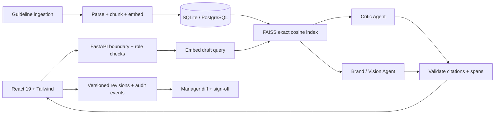

# BrandGuard AI

A functional pre-publication brand-governance MVP. Creators review drafts against active guideline sources, accept or reject cited suggestions, and hand a specific revision to a separate manager for final sign-off. Sign-off records approval; the product does not publish to a CMS.

## Local setup (Windows / PowerShell)

Prerequisites: Node.js 22+ and Python 3.13. Run from the repository root:

```powershell
python -m venv backend/.venv
backend/.venv/Scripts/python -m pip install -r backend/requirements.lock.txt
npm --prefix frontend ci
Copy-Item backend/.env.example backend/.env
npm --prefix frontend run build
backend/.venv/Scripts/python -m uvicorn backend.main:app --env-file backend/.env --host 127.0.0.1 --port 8000
```

Open **http://127.0.0.1:8000**. Interactive API documentation: **http://127.0.0.1:8000/docs**. No API keys are required for the default local demonstration. For later starts, use `backend/scripts/start.ps1` (or `-Install` to bootstrap dependencies). On macOS/Linux, replace `backend/.venv/Scripts/python` with `backend/.venv/bin/python`.

The entry screen offers Sign in, Create account, and Explore the demo. Accounts are stored in the server database; demo entry is an explicit sample-data path. The optional Take a tour control is available inside the workspace and never starts automatically. See [accounts and walkthrough](docs/ACCOUNTS_AND_TOUR.md) for configuration, APIs, and verification details.

Frontend development runs separately with `npm --prefix frontend run dev`; its Vite proxy forwards API requests to port 8000. Frontend source and build configuration are documented in [frontend/README.md](../frontend/README.md).

## Implemented workflow

1. Manager/admin ingests readable PDF, UTF-8 Markdown/TXT, or structured JSON. Documents are chunked to 1,000 characters with 200-character overlap. Embeddings are generated at ingestion and persisted with source metadata.
2. A creator posts text and optional artwork/declared metadata to `/api/v1/review`.
3. FAISS cosine similarity retrieves at most six relevant chunks. Live mode embeds the query through OpenAI; offline mode uses deterministic 384-dimensional hashed token vectors, which are lexical approximations, not learned semantic embeddings.
4. The Critic Agent checks tone, terminology, and claims; the Brand Agent checks visual identity. Live agents execute concurrently using structured outputs. Offline agents enforce explicit source rules and declared metadata.
5. Findings have exact UTF-16 spans, citations, severity, explanations, and suggested rewrites. Invalid model citations/spans fail the review instead of returning an untrustworthy clean result.
6. The server applies accepted rewrites, shifts later spans, preserves the original, and appends decisions to the review's audit trail. Rejected findings retain risk penalties. Manual changes need a new audit.
7. Handoff performs a final review of the revised content. A separate manager sees the diff, context, score, and audit trail. Open/rejected risks, stale policies, and uninspected image attachments block approval.

## Architecture and decisions



- **FastAPI** provides asynchronous provider requests, multipart parsing, typed contracts, and OpenAPI. PDF extraction runs in a worker thread. Small SQLAlchemy transactions and local FAISS computations are bounded MVP operations; load testing and a background ingestion queue remain future work.
- **SQLite** makes installation easy; **PostgreSQL** is supported through SQLAlchemy by setting `DATABASE_URL=postgresql+psycopg://...`. Reviews use optimistic compare-and-swap version checks. Source/review JSON records avoid a premature multi-table domain model. Schema migrations are needed before later schema changes.
- **FAISS** is the selected user-authorized vector fallback. Embeddings are durable in SQL; the small FAISS index is reconstructed in memory for each retrieval. No Pinecone account is required. Pinecone is not implemented.
- **Source-grounded agents:** context is bounded, citations must exist in retrieved sources, and draft/source content is explicitly untrusted. These controls reduce unsupported outputs; they cannot guarantee factual truth or complete recall.
- **Non-destructive revisions:** the original is retained; only explicitly accepted text is replaced. Visual artwork is never automatically edited. Re-audits create separate review records rather than modifying approved records.
- **Score:** `max(0, 100 − 12·high − 7·medium − 3·low)` over findings that have not been accepted. It is a weighted quality signal, not a compliance certification or probability.

## API

All protected routes require a signed session in authenticated mode. Default demo mode uses a clearly disclosed `X-Demo-Role: creator|manager|admin` header. Never expose demo mode to an untrusted network.

| Method | Route | Purpose / role |
| --- | --- | --- |
| GET | `/api/v1/health` | Engine and environment disclosure |
| POST | `/api/v1/auth/login` | Password login; HttpOnly signed session |
| POST | `/api/v1/auth/register` | Persistent creator account; configurable registration |
| GET | `/api/v1/auth/me` | Current identity |
| POST | `/api/v1/auth/logout` | Clear session |
| GET | `/api/v1/guidelines` | List sources; authenticated |
| POST | `/api/v1/guidelines` | Structured source ingestion; manager/admin |
| POST | `/api/v1/guidelines/upload` | Multipart `file`; manager/admin |
| PATCH | `/api/v1/guidelines/{id}` | `{active: boolean}`; manager/admin |
| POST | `/api/v1/review` | Create a review; creator/admin |
| GET | `/api/v1/reviews` | Creator-owned or manager/admin reviews |
| GET | `/api/v1/reviews/{id}` | Retrieve an authorized review |
| POST | `/api/v1/reviews/{id}/actions` | Revision decisions and sign-off |

Review input:

```json
{"title":"Launch post","channel":"LinkedIn post","text":"Our revolutionary platform starts at $29/month.","visual":{"colors":[],"logoPosition":"","image":""}}
```

Finding contract:

```json
{"id":"opaque-id","startIndex":4,"endIndex":17,"flaggedText":"revolutionary","ruleCategory":"Tone & messaging","ruleCitation":"Section 1.1: Tone of Voice","explanation":"Use tangible value rather than hype.","suggestedRewrite":"thoughtfully designed","severity":"medium","target":"text","status":"open"}
```

Text indexes use JavaScript-compatible UTF-16 code units and an exclusive end. Visual findings have `target: visual` and offsets `0,0`; update the artwork/metadata and re-audit to resolve them.

Action input: `{version: 1, action: "accept", issueId: "...", comment: "..."}`. Actions: `accept`, `reject`, `reopen`, `submit`, `approve`, `return`. Conflicts return 409. Invalid input returns 422. Provider failures return 503 and do not silently fall back. Review text is capped at 20,000 characters, guideline uploads at 4 MB / 100 PDF pages / 60,000 extracted characters, and UI images at 3 MB / server images at 20 megapixels.

## Guidelines and offline behavior

[example-guideline.json](example-guideline.json) demonstrates custom offline rules. Uploaded patterns are **literal phrases**, escaped on ingestion to avoid untrusted regex execution. Built-in demo rules include trusted regexes for prices and uptime. Plain PDF/Markdown sources have no automatically inferred offline enforcement rules; use live mode for interpretation or structured JSON for deterministic coverage. Scanned PDFs require OCR outside this MVP and are rejected if no text is extractable.

Local backend mode provides real ingestion, persisted embeddings, FAISS retrieval, SQL reviews, and server-enforced transitions, without paid AI. Browser-only fallback is independently labeled and uses localStorage and the explicit demo rules, without FAISS or semantic RAG. It is useful as a judge demonstration, not a shared production workspace.

## Live AI and authenticated deployment

Set these only in backend environment/secrets:

```dotenv
AI_MODE=live
OPENAI_API_KEY=your-server-side-key
AI_MODEL=gpt-4.1-mini
EMBEDDING_MODEL=text-embedding-3-small
DEMO_MODE=false
ALLOWED_ORIGINS=https://your-brandguard-domain.example
```

The model is configurable; verify account availability before enabling. Both agents use the OpenAI Responses API and Pydantic structured outputs; image attachments are passed only to the Brand Agent. Embeddings use the Embeddings API. Requests use timeouts and one retry. `store=False` is sent for model responses; check your provider's actual retention and contractual settings before uploading proprietary material. Switching embedding models rebuilds stored embeddings on startup.

Use `python backend/scripts/configure_users.py` to generate separate creator/manager/admin account configuration. Store its `SESSION_SECRET` and `BRANDGUARD_USERS` output in the server secret store or private `backend/.env`. Passwords are salted PBKDF2-SHA256 hashes; production sessions are HMAC-signed, expire after eight hours, and use Secure/HttpOnly/SameSite=Strict cookies. Role checks, creator ownership, a separate manager identity, version checks, and policy snapshots are server-enforced. Use HTTPS and a persistent database/volume.

The Dockerfile and Compose example are included as deployment packaging. From the repository root: `docker compose -f backend/compose.yaml up --build`. They have not been executed in this environment. Compose binds to loopback by default; put a TLS reverse proxy in front for external access. Keep `DEMO_MODE=false` for any sensitive deployment. `Dockerfile.dockerignore` excludes environments, dependencies, secrets, databases, and test artifacts from the build context.

## Verification and submission

```powershell
New-Item -ItemType Directory -Force backend/tmp | Out-Null
backend/.venv/Scripts/python -m pytest backend -q --basetemp=backend/tmp/pytest -o cache_dir=backend/.pytest_cache
npm --prefix frontend test
npm --prefix frontend run build
```

See [validation](docs/VALIDATION.md), [judge demonstration](docs/DEMO.md), and [structured feedback](docs/FEEDBACK.md). These distinguish implemented behavior, executed checks, and remaining deployment validation. No external user testing is claimed.

## Production readiness boundary

This is a deployable MVP foundation, not a certified enterprise compliance system. Required before broad production rollout: execute hosted TLS/database backup and restore checks, provider-backed text/image evaluations, PostgreSQL concurrency/load tests, independent security/accessibility review, organizational privacy review, and real user testing. Multi-tenant isolation, SSO, password reset/revocation, tamper-evident external audit storage, distributed rate limiting, OCR, CMS publishing, and sophisticated logo geometry detection are not implemented. Current rate limits are per process/IP; put a production gateway in front. Database administrators can modify stored JSON audit records; the trail is application-managed, not immutable storage.

## Libraries, APIs, and data

FastAPI/Starlette, Uvicorn, SQLAlchemy, psycopg, NumPy, FAISS CPU, OpenAI Python SDK, pypdf, Pillow, python-multipart, HTTPX, pytest; see the resolved lock file. Frontend libraries are listed in its README. Data consists exclusively of synthetic guidelines and campaign text in `frontend/shared/`. No scraped or customer dataset is bundled. The supplied Round 1 brief informed the workflow; its numerical market claims and guarantees were not reused as verified product claims.

Official API references: [FastAPI uploads](https://fastapi.tiangolo.com/tutorial/request-files/), [OpenAI structured outputs](https://developers.openai.com/api/docs/guides/structured-outputs), [Responses API](https://developers.openai.com/api/reference/resources/responses/methods/create). API schemas are generated at `/openapi.json`.

## Contributing and security

Keep code, dependencies, and tooling under `frontend/` or `backend/`. Add meaningful tests when changing review transitions, ownership, retrieval grounding, or offset handling. Do not commit `.env`, session secrets, API keys, documents, runtime databases, localStorage exports, or generated environments. Report vulnerabilities privately to the repository owner, with reproducible steps and synthetic data. Do not upload confidential drafts to a public issue.
